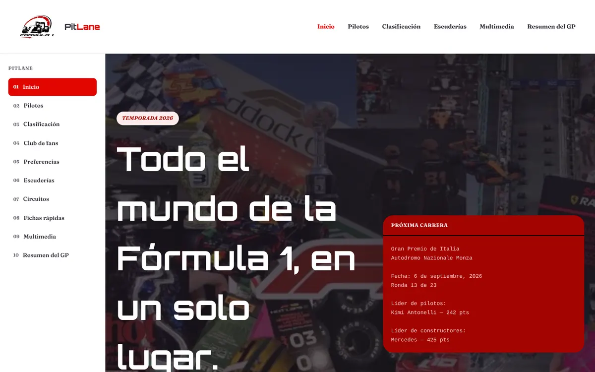
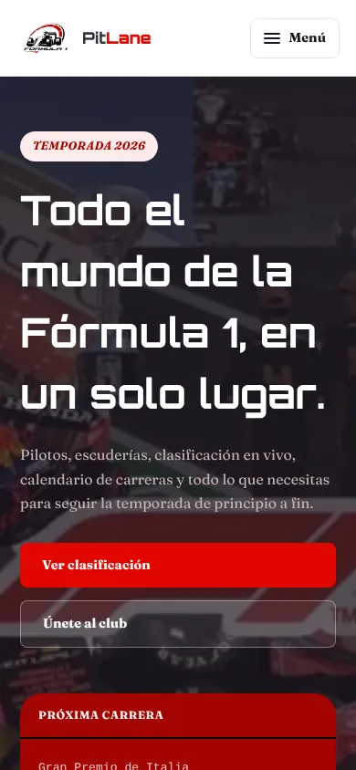

# PitLane

Portal de Fórmula 1 con pilotos, clasificación, escuderías, circuitos, fichas rápidas, multimedia y el resumen del último Gran Premio, más un club de fans y una página de preferencias. Empezó como laboratorio de HTML y CSS en la materia Construcción de Software (Ingeniería de Sistemas, Universidad Santo Tomás, Tunja) y se terminó como proyecto de portafolio.

**Sitio publicado:** https://pitlane-kyotto44.netlify.app

<p>
  
  
</p>

## Funcionalidades

- **Diez páginas** con una barra lateral numerada (01 a 10) y la sección actual marcada.
- **Menú móvil**: en pantallas de hasta 850 px el botón "Menú" abre la barra lateral como panel. Se cierra con Escape y el foco no se escapa del panel mientras está abierto.
- **Preferencias** (`preferencias.html`): eliges piloto y escudería favoritos, nombre, foto y color de acento. Se guardan en el navegador y se aplican al resto del sitio: tus favoritos se resaltan en Pilotos, Clasificación, Escuderías y Resumen del GP, y la barra lateral muestra un saludo con tu nombre y foto. La contraseña del formulario nunca se guarda.
- **Club de fans** (`club.html`): registro con validación en línea (sin ventanas de `alert`), confirmación y opción de editar. Si ya te registraste, la página abre en la confirmación.
- **Predicción del podio** (`resumen.html`): eliges un piloto y tu nivel de confianza; la predicción queda guardada para cuando vuelvas.
- **Tabla de clasificación ordenable**: clic (o Enter) en un encabezado ordena por esa columna; un segundo clic invierte el orden.
- **Ventanas emergentes** de circuitos y fichas: funcionan solo con CSS y el JavaScript agrega foco correcto, cierre con Escape y bloqueo del desplazamiento de fondo.
- **Accesibilidad**: enlace "Saltar al contenido", un `<h1>` por página, foco visible, errores asociados a cada campo y respeto por la preferencia de movimiento reducido.
- **Sin almacenamiento disponible** (por ejemplo en modo privado estricto), los formularios siguen funcionando y avisan que no se pudo guardar.

## Tecnologías

- HTML5 y CSS3 sin frameworks. El CSS está dividido por responsabilidad en `css/` y `css/styles.css` importa todos los archivos.
- JavaScript sin frameworks, un archivo por función en `js/`.
- Google Fonts: Orbitron (títulos) y Fraunces (texto); los datos de las fichas usan Courier New.
- Imágenes en formato WebP.

## Cómo abrirlo

No necesita instalación ni servidor: abre `index.html` con doble clic o con la extensión **Live Server** de Visual Studio Code. Las fuentes se cargan desde Google Fonts, así que con internet se ven como en las capturas.

> Algunos navegadores, como Firefox, pueden separar el almacenamiento de cada archivo abierto con doble clic. Si tus preferencias no aparecen en otras páginas, ábrelo con Live Server.

## Estructura de carpetas

```
pitlane/
├── index.html            Inicio y próxima carrera
├── pilotos.html          Pilotos de la parrilla y ficha destacada
├── clasificacion.html    Campeonato de pilotos (tabla ordenable)
├── club.html             Registro al club de fans
├── preferencias.html     Perfil de fan y favoritos
├── equipos.html          Escuderías y parrilla de salida
├── circuitos.html        Circuitos icónicos con ventanas emergentes
├── fichas.html           Consulta rápida
├── multimedia.html       Video y mapa rumbo al GP de Italia
├── resumen.html          Resumen del GP y predicción del podio
├── favicon.svg
├── css/                  Estilos por componente (styles.css los importa)
├── js/
│   ├── almacen.js        Lectura y escritura segura en localStorage
│   ├── validacion.js     Errores en línea para los formularios
│   ├── menu.js           Menú móvil
│   ├── favoritos.js      Resalta tus favoritos y muestra el saludo
│   ├── preferencias.js   Formulario de preferencias
│   ├── club.js           Registro del club de fans
│   ├── prediccion.js     Predicción del podio
│   ├── tabla-ordenable.js
│   └── modales.js        Mejoras de las ventanas emergentes
├── imagenes/             Fotos y logos en WebP
├── docs/                 Capturas usadas en este README
├── netlify.toml          Cabeceras de seguridad y caché para Netlify
├── README.md
└── CAMBIOS.md            Qué se cambió al terminar el proyecto y por qué
```

## Seguridad

Es un sitio estático: no tiene servidor, base de datos, claves de API ni funciones en la nube, así que no hay nada que un bot pueda usar para gastar recursos o leer datos.

- `netlify.toml` agrega cabeceras de seguridad en Netlify: una política de contenido (`Content-Security-Policy`) que solo permite los recursos que el sitio usa, bloqueo para que otras páginas no lo metan en un `iframe`, `nosniff`, HTTPS obligatorio y caché para las imágenes.
- Solo carga archivos propios, Google Fonts y los mapas y videos incrustados de Google Maps y YouTube. Los formularios no envían datos a ningún servidor: todo queda en el navegador de quien los usa.

## Créditos

- Las imágenes son de terceros y se usan con fines educativos. Los nombres y logos de equipos, pilotos y la Fórmula 1 pertenecen a sus dueños.
- Las clasificaciones y fechas de la temporada 2026 son datos de ejemplo escritos a mano.
- Orbitron y Fraunces son fuentes de código abierto de sus respectivos autores.
